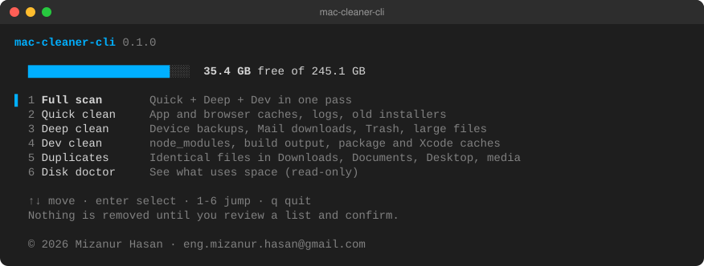
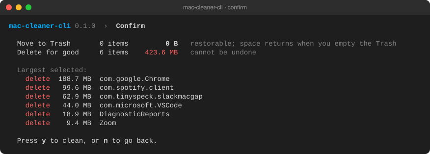
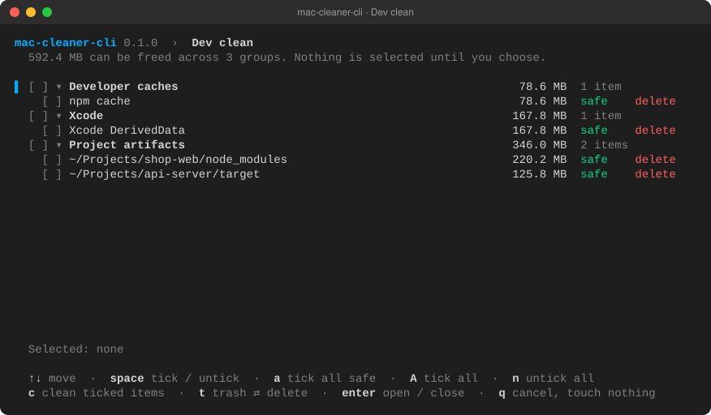
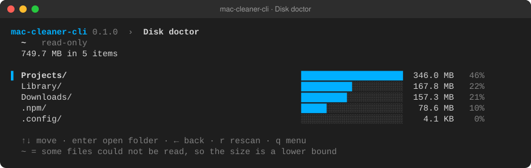

# mac-cleaner-cli

**A free, open-source Mac cleaner for the terminal.** Scan your Mac, review what is taking space,
choose item by item, then clean or cancel. Removes app and browser caches, logs, old installers,
`node_modules`, Xcode data, device backups, large files and duplicates.

Single static binary (about 6 MB). No install, no runtime, no account, no network access.

### ⬇️ [Download Mac-Cleaner (.zip)](https://github.com/mizanurhasan0/mac-cleaner-cli/raw/main/dist/Mac-Cleaner.zip)

One click, one file. Works on Apple Silicon and Intel Macs.
[All releases](https://github.com/mizanurhasan0/mac-cleaner-cli/releases)

## Quick start

### Option 1: one command (easiest, no warnings)

Open **Terminal** and paste this line:

```bash
bash -c "$(curl -fsSL https://raw.githubusercontent.com/mizanurhasan0/mac-cleaner-cli/main/install.sh)"
```

The command downloads the latest `Mac-Cleaner.command` and runs it. macOS shows no security warning
because the file is run through `bash`. (A `.sh` file cannot be double-clicked on a Mac; it opens in a
text editor, so the command is the way to start it.) Nothing stays on your Mac after you quit.

### Option 2: download the zip

1. [**Download Mac-Cleaner.zip**](https://github.com/mizanurhasan0/mac-cleaner-cli/raw/main/dist/Mac-Cleaner.zip) and double-click it to unpack **`Mac-Cleaner.command`**.
2. Open **Terminal** and run (drag the file into Terminal if your path differs):

```bash
bash ~/Downloads/Mac-Cleaner.command
```

3. Pick a mode, review the list, press `a` then `c`, confirm with `y`.

### If macOS says "Mac-Cleaner.command Not Opened" with only "Move to Trash"

The file is not signed by Apple, so a double-click is blocked on recent macOS versions. Use either:

- **Run it with `bash`** (Option 2 above). This always works.
- **Allow it once:** double-click the file, close the warning, open **System Settings → Privacy &
  Security**, scroll down to the message about `Mac-Cleaner.command` and click **Open Anyway**.
- **Remove the download flag:** `xattr -d com.apple.quarantine ~/Downloads/Mac-Cleaner.command`

Works on Apple Silicon and Intel Macs. Nothing else needs to be installed.

## Screenshot tutorial

The screenshots below were taken from the real app on sample data. Your numbers will differ.

### Step 1: pick a mode

Run the program. The top bar shows your free disk space. Press a number to choose a mode
(`2` is the safest place to start), or use `↑` `↓` and `enter`.



### Step 2: review what was found

After a short scan you get a list grouped by category. Nothing is ticked yet.
Each row shows the size, a risk label (**safe** or **review**) and the action (**delete** or **trash**).
Press `enter` on a group to open or close it.


### Step 3: tick what you want to clean

Press `space` to tick one item, or `a` to tick every **safe** item at once.
The line at the bottom shows how much will be cleaned. The **review** item here (an old installer)
stays unticked until you decide. Press `t` to switch an item between **trash** (restorable) and
**delete** (permanent).


### Step 4: confirm

Press `c`. A summary shows how much goes to the Trash and how much is deleted for good, plus the
largest items. Press `y` to run, or `n` to go back. Nothing has been touched until this point.



### Step 5: done

The report shows how much was cleaned and your free space before and after. Items sent to the Trash
free their space once you empty the Trash. Every action is saved to the history log.
Press any key for the menu, or `q` to quit.


### More modes

**Dev clean** (`4`) finds package caches, Xcode data and old project folders such as `node_modules`
and `target`:



**Disk doctor** (`6`) is a read-only folder browser that shows what uses your space. It never
removes anything:



## Build from source

```bash
go build -o mac-cleaner-cli .
./mac-cleaner-cli              # menu
./mac-cleaner-cli quick        # or: full | deep | dev | dupes | disk
./mac-cleaner-cli full --dry-run
./mac-cleaner-cli dev --plain  # text report, read-only, no TUI
```

Flags work before or after the mode. `./package.sh` builds the one-file `dist/Mac-Cleaner.command`
(universal arm64 + Intel).

## Modes

| Mode | Looks at |
|---|---|
| full | quick + deep + dev in one pass |
| quick | `~/Library/Caches`, browser caches, `~/Library/Logs`, installers in Downloads older than 14 days |
| deep | iPhone/iPad backups, Mail downloads, Finder Trash, files over 500 MB |
| dev | `node_modules`, `target`, `.next`, `dist`, `build`, `venv`, `Pods`; npm, pnpm, Yarn, pip, Homebrew, Go, Gradle, Maven caches; Xcode DerivedData and simulators |
| dupes | identical files (size → 64 KB hash → full SHA-256) in Downloads, Documents, Desktop, Pictures, Movies, Music |
| disk | read-only folder browser with sizes; nothing is removed |

## Keys (review screen)

| Key | Action |
|---|---|
| `↑` `↓` | move |
| `space` | tick / untick |
| `a` / `A` | tick all safe / tick all |
| `n` | untick all |
| `t` | switch trash ⇄ delete |
| `enter` | open / close a group |
| `c` | clean ticked items |
| `q` / `esc` | cancel, touch nothing |

## Safety

- Scans only read. Nothing is selected until you choose.
- Each item shows **safe** or **review**, and **trash** (restorable) or **delete** (permanent).
  You can flip that per item with `t`.
- A review item set to *delete* needs you to type `delete` before it runs.
- Duplicates always keep at least one copy.
- Hard guard on every removal: only inside `$HOME`; refuses `~`, `~/Documents`, `~/Library`, `.ssh`,
  iCloud and Keychains; skips symlinks. See `internal/clean/clean.go` and its tests.
- Refuses to run as root. User-level files only, never `sudo`.
- Every action is logged to `~/.config/mac-cleaner-cli/history.log`.
- `--dry-run` goes through the whole flow and removes nothing.

## Permissions

On first run macOS may ask to let Terminal access Documents, Downloads or Desktop. Click **Allow**.
Grant Full Disk Access to Terminal for complete totals.

## Not in v0.1

App-leftover detection, Time Machine snapshots and system caches (these need admin rights),
Docker, an undo screen.

## Author

**Mizanur Hasan**
Email: [eng.mizanur.hasan@gmail.com](mailto:eng.mizanur.hasan@gmail.com)
LinkedIn: [linkedin.com/in/mizanur-hasan](https://www.linkedin.com/in/mizanur-hasan/)

Bug reports and ideas are welcome via GitHub Issues.

## License

MIT License. Copyright © 2026 Mizanur Hasan. See [LICENSE](LICENSE).

This software is provided as is, without warranty. Review each list before cleaning.
