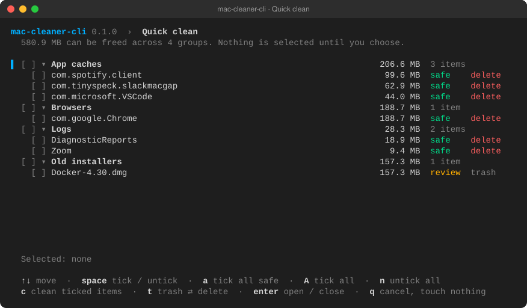
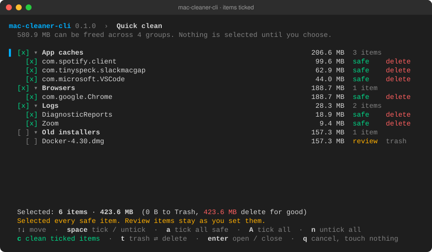
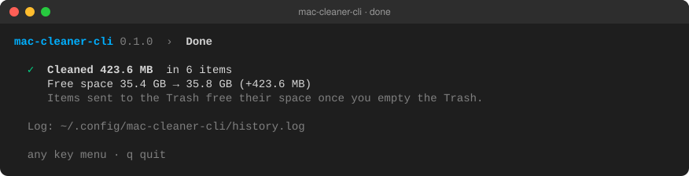

# mac-cleaner-cli

**Free, open-source Mac cleaner for the terminal.**
Scan, review, tick what you want, clean. Nothing is removed until you confirm.

Removes app and browser caches, logs, old installers, `node_modules`, Xcode data, device backups,
large files and duplicates. One file, no install, no account, no internet needed to run.

Works on Apple Silicon and Intel Macs.

---

## Get started

Open **Terminal**, paste this line, press `enter`:

```bash
bash -c "$(curl -fsSL https://raw.githubusercontent.com/mizanurhasan0/mac-cleaner-cli/main/install.sh)"
```

That is all. It downloads the app, runs it, and leaves nothing behind.

**Prefer a file?** [Download Mac-Cleaner.zip](https://github.com/mizanurhasan0/mac-cleaner-cli/raw/main/dist/Mac-Cleaner.zip),
unzip it, then run:

```bash
bash ~/Downloads/Mac-Cleaner.command
```

> **Why not double-click?** The file is not signed by Apple, so macOS blocks it ("Move to Trash").
> Running it with `bash` avoids this. Or open **System Settings → Privacy & Security** and click
> **Open Anyway**.

---

## How to use it

### 1. Pick a mode

Press a number. Start with `2` (Quick clean).


### 2. Review the list

Nothing is ticked yet. Each row shows its size, a risk label and what will happen.



### 3. Tick what you want

`space` ticks one item. `a` ticks all **safe** items. The bottom line shows the total.



### 4. Confirm

Press `c`, check the summary, press `y` to clean or `n` to go back.


### 5. Done

See how much was cleaned. Press `q` to quit.



**Want to try it first?** Add `--dry-run`. It runs the whole flow and removes nothing.

```bash
./mac-cleaner-cli quick --dry-run
```

---

## Modes

| Key | Mode | Finds |
|---|---|---|
| `1` | **Full scan** | Quick + Deep + Dev together |
| `2` | **Quick clean** | App and browser caches, logs, installers older than 14 days |
| `3` | **Deep clean** | iPhone/iPad backups, Mail downloads, Trash, files over 500 MB |
| `4` | **Dev clean** | `node_modules`, build folders, npm/pip/Homebrew/Go/Gradle caches, Xcode data |
| `5` | **Duplicates** | Identical files over 1 MB in Downloads, Documents, Desktop, Pictures, Movies, Music |
| `6` | **Disk doctor** | Shows what uses space. Read-only |


---

## Labels

| Label | Meaning |
|---|---|
| **safe** | Rebuilt or re-downloaded automatically |
| **review** | Could matter to you (backups, big files, Trash). Check first |
| **trash** | Moved to the Trash. You can restore it |
| **delete** | Removed permanently |

Press `t` to switch an item between **trash** and **delete**.

---

## Keys

| Key | Action |
|---|---|
| `↑` `↓` | Move |
| `space` | Tick / untick |
| `a` | Tick all safe |
| `A` | Tick all |
| `n` | Untick all |
| `t` | Trash ⇄ delete |
| `enter` | Open / close group |
| `c` | Clean ticked items |
| `q` / `esc` | Cancel, touch nothing |

---

## Safety

- Scanning only reads. Nothing is ticked for you.
- Deleting a **review** item permanently needs you to type `delete`.
- Duplicates always keep one copy.
- Only touches files inside your home folder. Refuses the home folder itself, Documents, Desktop,
  `.ssh`, Keychains, iCloud, Mail, Messages, and symbolic links.
- Never runs as root, never uses `sudo`.
- Every action is logged to `~/.config/mac-cleaner-cli/history.log`.

---

## Permissions

If the scan seems stuck, a macOS popup may be waiting behind the window. Click **Allow**.

For full results: **System Settings → Privacy & Security → Full Disk Access → turn on Terminal**.

---

## FAQ

**Free space did not change after cleaning.**
Items sent to the Trash free space only after you empty the Trash.

**Can I undo?**
Items marked **trash** can be restored from the Trash. Items marked **delete** cannot.

**Does it need Go, Homebrew or internet?**
No.

**`--plain` shows an error.**
It needs a mode: `./mac-cleaner-cli --plain dev`.

---

## Command line

```bash
./mac-cleaner-cli                 # menu
./mac-cleaner-cli quick           # full | deep | dev | dupes | disk
./mac-cleaner-cli full --dry-run  # remove nothing
./mac-cleaner-cli dev --plain     # text report, no interface
./mac-cleaner-cli --version
```

## Build from source

Requires [Go](https://go.dev/dl/) (version in `go.mod`).

```bash
go build -o mac-cleaner-cli .
./package.sh        # builds dist/Mac-Cleaner.command and dist/Mac-Cleaner.zip
```

## Uninstall

Delete the file. To also remove the log: `rm -rf ~/.config/mac-cleaner-cli`

---

## Author

**Mizanur Hasan**
[eng.mizanur.hasan@gmail.com](mailto:eng.mizanur.hasan@gmail.com) ·
[LinkedIn](https://www.linkedin.com/in/mizanur-hasan/)

## License

MIT. Copyright © 2026 Mizanur Hasan. See [LICENSE](LICENSE).
Provided as is, without warranty. Review each list before cleaning.
